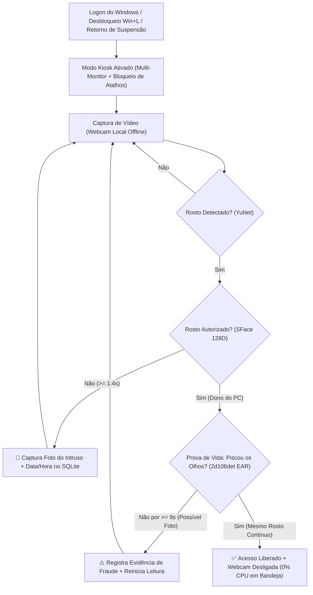

# 🛡️ SentinelPC — Autenticação Facial Corporativa para Windows

O **SentinelPC** é um sistema de segurança corporativa para estações Windows desenvolvido para **impedir o uso não autorizado de computadores por terceiros dentro do ambiente de trabalho**.

Assim que o Windows inicia — ou sempre que a tela é desbloqueada (`Win+L`) / retorna de suspensão — o aplicativo assume o controle em **Modo Kiosk Multi-Monitor**, exigindo o **reconhecimento facial do dono do computador** aliado a **Prova de Vida real (piscada dos olhos)** antes de liberar o uso da máquina, fotografando silenciosamente qualquer tentativa de acesso indevido para auditoria da TI.

---

## 🎯 Como o Projeto Funciona



### 1. Gatilhos Nativos do Windows (`Win32 API`)
- **Inicialização Automática**: registra-se em `HKCU\Software\Microsoft\Windows\CurrentVersion\Run` para bloquear o computador assim que a sessão do Windows inicia.
- **Monitoramento de Sessão e Energia**: uma thread nativa Win32 (`WTSRegisterSessionNotification` + `WM_POWERBROADCAST`) detecta instantaneamente quando alguém desbloqueia a tela (`WTS_SESSION_UNLOCK`) ou acorda o PC de suspensão/hibernação, exigindo nova validação facial.
- **Execução Leve em Segundo Plano**: após autenticar o dono do PC, a webcam é totalmente liberada (ficando disponível para reuniões no Teams, Meet ou Zoom) e o aplicativo permanece na **Bandeja do Sistema** consumindo ~0% de CPU até o próximo bloqueio.

### 2. Bloqueio de Tela Kiosk & Multi-Monitor
- **Cobertura de Múltiplos Monitores**: exibe o scanner biométrico no monitor principal e aplica janelas *blackout* em tela cheia em todos os monitores secundários, impedindo leitura ou interação em telas extras.
- **Interceptação de Teclas (`WH_KEYBOARD_LL`)**: bloqueia em baixo nível atalhos de fuga como `Win`, `Alt+Tab`, `Alt+F4`, `Alt+Esc`, `Alt+Space`, `Ctrl+Esc`, `Ctrl+Shift+Esc` e `PrintScreen`.
- **Ocultação Segura da Barra de Tarefas**: oculta `Shell_TrayWnd` e `Shell_SecondaryTrayWnd` durante o bloqueio e garante restauração automática via *failsafe* (`atexit` / `finally`).

### 3. Pipeline Biométrico 100% Offline + Prova de Vida Anti-Foto
Todo o processamento ocorre localmente na CPU da estação, sem enviar imagens para nuvem:
1. **Detecção Facial (`YuNet`)**: localiza o rosto e 5 pontos de referência com baixa latência.
2. **Reconhecimento Facial (`SFace 128D`)**: alinha o rosto e extrai um vetor matemático de 128 dimensões, comparando por similaridade de cosseno contra as **5 amostras biométricas** cadastradas do dono do PC.
3. **Prova de Vida por Piscada (`InsightFace 2d106det`)**:
   - Extrai 106 pontos faciais em tempo real para medir a abertura das pálpebras (*Eye Aspect Ratio — EAR*) com calibração adaptativa para o formato de olho do usuário.
   - Exige uma sequência contínua **Olhos Abertos → Piscada → Olhos Reabertos** no **mesmo rosto rastreado espacialmente**, impedindo fraudes com fotos estáticas exibidas na tela do celular.

### 4. Auditoria Fotográfica de Intrusos
O sistema fotografa automaticamente pela webcam e grava uma **tarja forense na imagem** (contendo data, hora, nome da máquina, usuário do Windows e *score* biométrico) em três situações:
- `INTRUSO_DETECTADO`: pessoa não cadastrada permanece em frente ao PC bloqueado tentando utilizá-lo;
- `FALHA_PROVA_VIDA`: imagem semelhante ao dono é exibida sem piscar por tempo prolongado (tentativa com foto);
- `SENHA_TI_INVALIDA`: digitação incorreta da Senha Mestre da TI na contingência ou na Bandeja do Sistema.

### 5. Painel Administrativo da TI & Contingência
- Protegido por **Senha Mestre da TI** com hash criptográfico `PBKDF2-HMAC-SHA256` (200.000 iterações + *salt* aleatório).
- Permite **liberação de contingência** diretamente na tela de bloqueio caso a webcam sofra defeito físico.
- Oferece interface em tema escuro (`CustomTkinter`) para cadastrar/remover colaboradores, simular prova de vida ao vivo, inspecionar as fotos dos intrusos e ajustar o rigor biométrico.
- Encerrar o aplicativo pela Bandeja do Sistema também exige a Senha Mestre da TI.

---

## 📁 Estrutura do Projeto

```text
Segurança_PC/
├── assets/
│   ├── icon.ico                                    # Ícone corporativo do aplicativo e bandeja
│   └── models/
│       ├── face_detection_yunet_2023mar.onnx       # Detector facial YuNet (OpenCV Zoo)
│       ├── face_recognition_sface_2021dec.onnx     # Reconhecedor facial SFace 128D
│       └── 2d106det.onnx                           # Malha facial de 106 pontos (Prova de Vida)
├── src/
│   ├── app_controller.py   # Orquestrador central, Bandeja do Sistema (pystray) e eventos
│   ├── icon_gen.py         # Geração programática do ícone vetorial
│   ├── paths.py            # Resolução de caminhos (modo dev, PyInstaller e %LOCALAPPDATA%)
│   ├── storage.py          # Banco SQLite, PBKDF2-SHA256, embeddings e evidências fotográficas
│   ├── ui_admin_panel.py   # Painel Administrativo da TI e Assistente de Primeiro Uso
│   ├── ui_lock_screen.py   # Tela de Bloqueio Kiosk Multi-Monitor e Contingência
│   ├── vision_engine.py    # Motor biométrico YuNet + SFace + Prova de Vida EAR 106-pontos
│   └── win_security.py     # Hooks Win32 64-bit, barra de tarefas, monitores e Registro Run
├── main.py                 # Ponto de entrada da aplicação (--startup / --admin)
├── build_exe.py            # Script automatizado de compilação PyInstaller (--onefile)
├── iniciar_sentinel.bat    # Atalho rápido de execução
├── gerar_exe.bat           # Atalho para compilar dist/SentinelPC.exe
└── requirements.txt        # Dependências do projeto
```

---

## 💻 Como Executar pelo Código-Fonte (Desenvolvimento)

### Pré-requisitos
- **Windows 10 ou Windows 11** (64 bits)
- **Python 3.11+**
- Webcam integrada ou USB

### Passo a passo
```powershell
# 1. Clone o repositório
git clone https://github.com/fareis2000/Seguran-a_IPC.git
cd Seguran-a_IPC

# 2. Crie o ambiente virtual e instale as dependências
python -m venv .venv
.\.venv\Scripts\pip install -r requirements.txt

# 3. Inicie o SentinelPC
.\.venv\Scripts\python.exe main.py
```

Para abrir diretamente a solicitação do **Painel da TI**:
```powershell
.\.venv\Scripts\python.exe main.py --admin
```

---

## 📦 Como Gerar e Implantar o Executável (`SentinelPC.exe`)

### 1. Gerar o `.exe` autônomo
Execute o script de empacotamento:
```powershell
.\gerar_exe.bat
```
Será gerado o arquivo único `dist\SentinelPC.exe` (com Python, bibliotecas gráficas e modelos ONNX todos embutidos).

### 2. Implantar em outros computadores da empresa
1. Copie **apenas** o arquivo `SentinelPC.exe` para uma pasta fixa da estação de destino (ex.: `C:\SentinelPC\SentinelPC.exe`).
   > **Importante:** Não execute diretamente de um pendrive ou pasta temporária, pois o aplicativo registra seu caminho atual na inicialização automática do Windows.
2. Abra `SentinelPC.exe` pela primeira vez:
   - Defina a **Senha Mestre da TI**.
   - Na aba **👤 Dono do PC & Cadastro Facial**, informe o nome do colaborador e clique em **📸 Capturar 5 Amostras e Cadastrar Rosto**.
   - Teste em **🧪 Modo Teste (Piscar)** e clique em **🔒 Bloquear e Testar Agora**.

---

## 🔒 Armazenamento Local, Privacidade e Hardening Corporativo

Todos os dados sensíveis ficam armazenados **exclusivamente na máquina local** (fora da pasta de código e ignorados pelo Git):
- **Banco SQLite (Criptografia de senha + vetores faciais)**: `%LOCALAPPDATA%\SentinelPC\sentinel_pc.db`
- **Fotos de Auditoria de Intrusos**: `%LOCALAPPDATA%\SentinelPC\intrusos\`
- **Logs Técnicos**: `%LOCALAPPDATA%\SentinelPC\logs\sentinel_pc.log`

### Recomendação complementar de Política de Grupo (GPO)
Como a sequência `Ctrl+Alt+Del` é interceptada diretamente pelo kernel do Windows (`winlogon.exe`), em empresas onde os colaboradores utilizam contas com permissão para encerrar processos recomenda-se desabilitar o Gerenciador de Tarefas para contas padrão via GPO:
- `gpedit.msc` → *Configuração do Usuário → Modelos Administrativos → Sistema → Opções de Ctrl+Alt+Del → Remover Gerenciador de Tarefas*.
